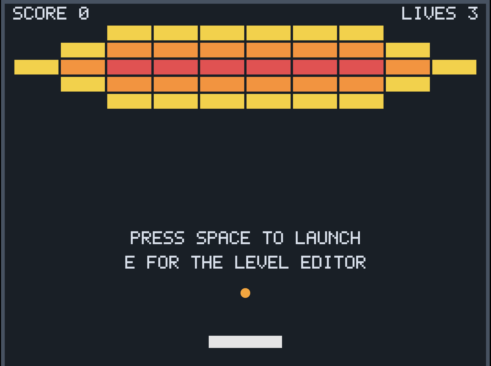
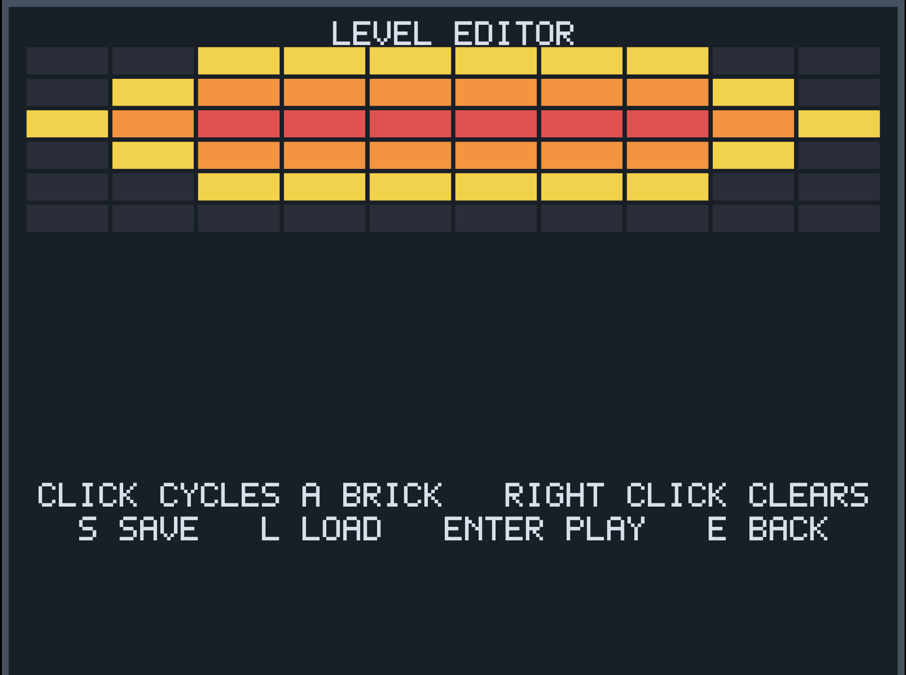

# Breakout


A Breakout clone in C++, written from scratch. No engine, no
gameplay framework, and no maths library: the only dependencies are GLFW for the
window, glad for the OpenGL loader, miniaudio for sound and GoogleTest for the
tests - all four vendored as source, so it builds with no network access.

It ships with an in-game level editor. Levels are plain text, so one built with
the mouse, one typed in Notepad and the one built into the game are the same
kind of thing.

**A prebuilt Windows build is on the releases page.**

| Playing | The same level, in the editor |
|---|---|
|  |  |

The editor writes the format the game already read, so there is no import step
and no second representation of a level.

## Building

Nothing is downloaded: GLFW, glad, miniaudio and GoogleTest are all in
`vendor/`, so this builds with no network access.

### Windows

Requires Visual Studio 2022 and CMake 3.21 or newer.

```
git clone https://github.com/khalidHsoliman/Breakout-game.git
cd Breakout-game
cmake --preset vs2022-x64
cmake --build build --config Release
```

The executable lands in `build/bin/Release/breakout.exe`.

To build the game without the test target, use the `vs2022-x64-notests` preset
instead.

### Linux: game logic and tests only

The window and sound layer is Windows only, so on Linux the option
`BREAKOUT_BUILD_PLATFORM=OFF` leaves out `breakout_platform`, GLFW, glad,
miniaudio and the `breakout` executable, and builds `breakout_game` and the
tests. It is `ON` by default, so the Windows build and presets are unaffected.
Requires a C and C++ compiler, make and CMake 3.21 or newer; on Ubuntu or
Debian:

```
sudo apt-get install -y build-essential cmake
git clone https://github.com/khalidHsoliman/Breakout-game.git
cd Breakout-game
cmake -S . -B build-linux -DBREAKOUT_BUILD_PLATFORM=OFF -DCMAKE_BUILD_TYPE=Debug
cmake --build build-linux -j
ctest --test-dir build-linux --output-on-failure
```

CMake from pip (`pip install cmake`) works too, but still needs `make`, or
`pip install ninja` and `-G Ninja`.

## Running the tests

```
ctest --test-dir build -C Debug
```

274 tests. CI runs them in Debug and Release on Windows for pushes and pull
requests to `main`. On Linux with GCC 13 they pass in both configurations and
build with no warnings.

## Controls

| Key | In the game |
|---|---|
| Left / Right | Move the paddle |
| Space | Launch the ball |
| P | Pause |
| R | Restart, after a win or a loss |
| E | Open the level editor |
| F11 | Toggle fullscreen |
| Escape | Quit |

| Input | In the editor |
|---|---|
| Left click | Cycle a cell: empty, 1, 2, 3, 4, steel, empty (a 5 to 9 from a file goes to empty) |
| Right click | Clear a cell |
| Left / Right | Pick a slot, 1 to 9 |
| S | Save the canvas to the slot |
| L | Load the slot into the canvas |
| Enter | Play the level on screen |
| E | Back to the game, discarding unsaved edits |

A brick's colour is its remaining toughness, so a level can be read at a glance
and a damaged brick recolours as it is hit. Steel is grey in the game.

## Power-ups

Every brick that is destroyed, whatever its toughness, has a 15% chance of
dropping a capsule where it was, and each of the two kinds is equally likely. A
capsule is 40 by 14 and falls straight down at 150 units a second. Touching the
paddle catches it; one that is missed disappears below the floor and costs
nothing. Catching one scores nothing. Steel is never destroyed, so it never
drops one.

| Capsule | Power-up |
|---|---|
| Blue, marked W | **Wide paddle.** The paddle is 180 wide instead of 120 for 10 seconds. Catching another restarts the 10 seconds without making it any wider. A paddle that widens against a wall is kept inside it, and the time does not run while the game is paused. |
| Green, marked M | **Multi-ball.** Two more balls leave from a ball still in play, at its speed, 30 degrees either side of straight up. There are never more than 5 balls: with 4 in play a catch adds one, with 5 it adds none. With no ball in play it does nothing. |

A life is lost only when the last ball in play falls, and only one life, however
many balls fall in the same step. Losing a life clears the capsules, puts the
paddle back to 120 and serves a single ball. The next level and R after a win
or a loss also start with no capsules, one ball and a normal paddle, and a win
clears the capsules still falling.

The numbers are in `include/game/Spawn.h` and, for the drop chance,
`include/game/World.h`.

## Steel

A `#` in a level file is a steel brick, which cannot be broken. The ball bounces
off it as off any brick, but a steel hit does no damage, scores nothing, drops
no capsule, makes no particles and does not speed the ball up. When a ball
touches a brick and steel in the same step, only the deeper contact counts, as
between two bricks.

A level is cleared when its last brick that can be broken goes, however much
steel is left. A file with only steel is refused, like one with no bricks.

The level check does not look at where the steel is, so a level can be made
that cannot be finished. The gaps between bricks are 4 units and the ball is 16
wide, so a brick boxed in by steel on every side can never be reached. This
level passes the check, and can only end in a game over:

```
###
#1#
###
```

### A ball stuck between steel

Steel can trap a ball. Before the rule below, in this level, with the ball
started at the centre of each cell of the middle row, going up and to the right
at every whole angle from 5 to 60 degrees off vertical, 11 of the 560 starts
had still not come back down below the bricks after 3 minutes, bouncing between
the steel rows or in the strip above the top one. With the rule, all 11 are
back on the paddle after exactly 10 seconds:

```
##########
..........
####.#####
........1.
```

So in a level with steel, a ball that goes 10 seconds without touching the
paddle or a brick that can be broken goes back onto the paddle, with no life
lost, to be served again. As after a lost life, the capsules still falling are
cleared and a wide paddle goes back to normal. If another ball is still in
play, the stuck one is just removed instead.

Each ball keeps its own time. Any hit on a brick that can be broken restarts it,
whether or not the brick breaks, and so do the paddle and being held on it;
steel and walls do not. The two balls a multi-ball adds start from zero. The
time does not run while the game is paused, and nothing random is involved, so
a seeded game still plays the same every time.

In a level without steel none of this runs, so those levels play exactly as
they did before steel: 20 games of 15 minutes each, played by the same autopilot
as the long-game test and compared after every step with the code from before
steel, came out identical.

The 10 seconds is `STUCK_BALL_TIME` in `include/game/Systems.h`.

## Levels

### The levels folder

Levels are read from a `levels` folder beside the executable (on Windows,
`build/bin/Release/levels/`), once, when the game starts. The files are named
`level-1.txt`, `level-2.txt`, `level-3.txt` and so on, and are played in that
order: clearing a level moves on to the next one with the score and lives kept,
clearing the last one is a win, and R after a win or a game over starts again
from the first level with a score of 0.

Reading stops at the first missing number, so with `level-1.txt` and
`level-3.txt` only the first is played. When the folder is missing, empty, or
holds no usable file, the game plays its built-in level. No `levels` folder
ships with the game.

The HUD shows LEVEL n, counting the levels that loaded. When a file is skipped,
the ones after it move up: with `level-2.txt` bad, `level-3.txt` is LEVEL 2.

### The file format

One line per row of bricks, top row first. A digit from 1 to 9 is a brick that
takes that many hits, `#` is a steel brick, and `.`, `0` or a space is an empty
cell. Rows may be of different lengths; short rows are padded with empty cells,
and trailing spaces count as columns. Blank lines above and below the grid are
ignored. LF and CRLF line endings both work, and so does a UTF-8 byte order mark
at the start, as Notepad may write.

```
..111111..
.12222221.
1233333321
```

### Bad files

A file is bad, and skipped, when:

- it holds any other character, a tab included
- it is empty or only blank lines
- it has no bricks, or only steel bricks, which could never be cleared
- a brick, steel included, is in row 18 or lower, counted from the first
  non-blank line, where it would overlap the ball held on the paddle (rows of
  only empty cells below the bricks are fine)
- a row is more than 47 columns wide, steel and spaces included, where a brick
  would be narrower than the distance the fastest ball moves in one step

The 17 rows and 47 columns are not typed in anywhere: they are worked out from
the game's own layout for its 800 by 600 play area.

A bad file is skipped and the other files still load. Each skipped file is
reported on stderr, which on Windows is the console window the game opens
with, with the file name, line and column in front:

```
level-2.txt:2:2: 'x' is not allowed: a level may only contain digits, '#', '.' and spaces
level-3.txt: the level has only steel bricks, which cannot be broken
level-4.txt:18:1: a brick in row 18 is too low: at most 17 rows fit above the paddle
```

Lines count from the top of the file, blank lines included; columns count from
1, and a byte order mark is not counted.

### Slots in the editor

The editor has nine slots, and they are the level files: slot n is
`levels/level-n.txt`. Saving creates the `levels` folder if it is missing and
overwrites the slot. A canvas with no bricks is not saved (NOTHING TO SAVE),
and Enter on one does nothing but show NOTHING TO PLAY, since clearing nothing
would be an instant win. A canvas whose only bricks are steel is not saved
either (NOTHING TO SAVE), and the file already in the slot is left as it was.
Steel is saved as `#` and loads back as steel.

Loading a slot uses the same checks as the game. A bad file shows BAD LEVEL FILE
and its full error goes to stderr. A file bigger than the editor's 10 by 6 grid
shows TOO BIG TO EDIT and is not loaded, so it is never cut down. A level
narrower than 10 columns does load, but it is saved back 10 columns wide, and
since brick width follows the number of columns, its bricks are narrower in
the game after that.

The folder is read only at startup, so a saved level joins the game the next
time it starts. A test play with Enter replaces the loaded levels with the
canvas, and R after it plays the canvas again; it stays that way until the game
is started again.

## How it is put together

Four layers, with the dependency direction enforced by CMake target linkage
rather than by convention:

```
                 breakout (main.cpp)
                 /                 \
        platform                    game
        Window, Renderer,           World, Systems, Level,
        Viewport, Font,             Spawn, Editor, LevelLayout,
        FileSystem, Audio           LevelCheck, LevelFiles,
                                    Input, Events
                 \                 /
                       core
                       Entity, ComponentStore, Color
                        |
                       math
                       Vec2, AABB, Circle, Collision
```

`platform` and `game` are **siblings**. Neither links the other, so the game
cannot draw and the renderer cannot know what a brick is; `main.cpp` is the only
place they meet. The include directory for glad is `PRIVATE` to the platform
target, so a stray `#include <glad/gl.h>` in the game layer does not compile.
The game layer does read and write level files, with `std::filesystem` only,
so that code is tested too; `main.cpp` just passes it the folder.

Entities are a strongly-typed id and components live in sparse sets - a dense
array for iteration, a sparse index for lookup. Systems are free functions over
the `World`. The game advances on a fixed 1/60 timestep with an accumulator, so
behaviour does not change with frame rate.

The only randomness that changes play - whether a brick drops a capsule, and
which kind - comes from a `std::mt19937` that belongs to the `World`. `main`
seeds it once at startup from `std::random_device`, R keeps using it rather than
starting it over, and the tests seed it themselves. The drops use the engine's
raw output rather than a `std::` distribution: the standard fixes the numbers an
engine produces from a seed, but not what the distributions make of them.
Particles and screen shake still use `std::rand`; they are for show, and a long
game played twice with different `std::rand` seeds ends the same, entity by
entity, apart from the particles.

Two tests check that the same seed and the same input give the same game. One
asserts that 600 steps produce identical results twice over. The other has an
autopilot play fifteen minutes of game time with power-ups, on the built-in
level and a second one, restarting after a win or a loss, and missing on
purpose now and then. It plays that game twice with the same seed and checks
that every component, the score, lives, state, level and the generator are
exactly equal at the end, and that capsules dropped, both kinds were caught,
some were missed, multi-ball added balls and lives were lost along the way. With
GCC 13 it ends the same in Debug and Release; other compilers have not been
checked.

Rendering is one dynamic vertex buffer and a single draw call per frame. Text is
a hand-encoded 5x7 bitmap font drawn as one quad per lit pixel through that same
batch, so there is no font library and no texture path. The play area keeps its
aspect ratio on any display, with black bars where the shapes disagree.

Sound works the same way the input does, in the opposite direction. `Window`
turns key presses into a `game::Input` that carries no key codes; systems raise
a `game::GameEvent` that carries no notion of sound, and `main` decides that a
brick makes a noise.

## AI assistance

Claude was used on this project for the following:

- **This README.**
- **The build setup** - `CMakeLists.txt`, `CMakePresets.json`, and the GitHub
  Actions workflow.
- **Refactoring** - suggesting cleaner shapes for parts of the code, most often
  pulling shared arithmetic out of the function it was buried in, which usually
  made it testable as a side effect.
- **Test cases** - deciding what was worth asserting, and drafting many of the
  assertions.
- **Exercising the game** - running builds, the clean-machine check, and
  verifying behaviour.

## References

- [glad](https://glad.dav1d.de/) - the OpenGL loader
- [glfw](https://www.glfw.org/) - the windowing library
- [googletest](https://github.com/google/googletest) - the test framework
- [miniaudio](https://miniaud.io) - audio playback, single header by David Reid
- [learnopengl.com, Audio](https://learnopengl.com/In-Practice/2D-Game/Audio) -
  which sounds a Breakout clone wants and when to play them. **The three sound
  files in `assets/` are the ones from this article.**
- [learnopengl.com](https://learnopengl.com) - shader compilation, vertex array
  and buffer setup, and the batched draw in `platform/Renderer`
- [Handmade Hero](https://handmadehero.org), day 277 - the sparse set entity
  storage in `core/ComponentStore`
- [Interpolation Tricks](https://solhsa.com/interpolation/), Jari Komppa - the
  smoothstep curve in `math/Lerp.h`, used to fade particles
- [Microsoft Learn](https://learn.microsoft.com/windows/win32/api/libloaderapi/nf-libloaderapi-getmodulefilenamew) -
  `GetModuleFileNameW`, and the truncation behaviour the growing buffer in
  `platform/FileSystem` exists to handle
